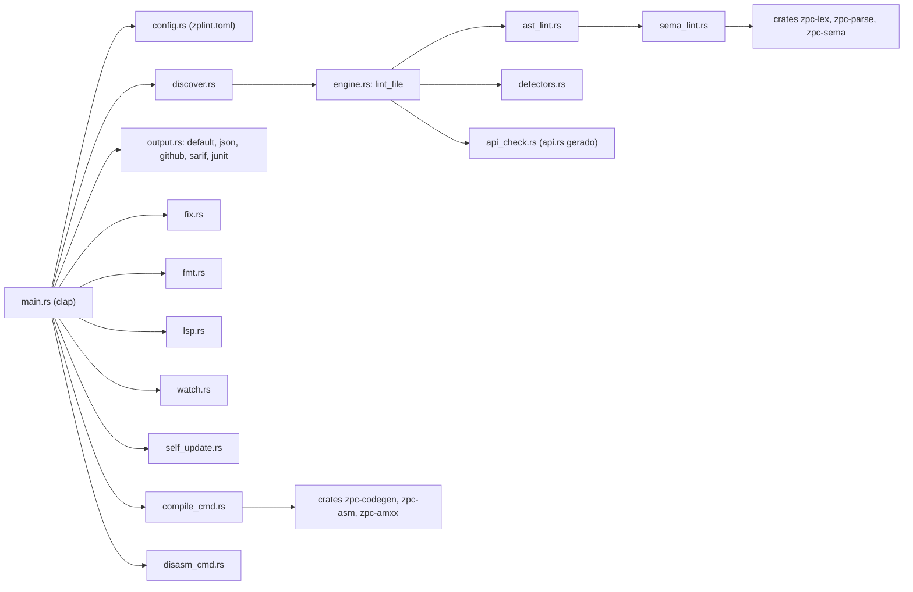

# zplint

[](https://github.com/juninmd/zplint/actions/workflows/ci.yml)
[](https://github.com/juninmd/zplint/actions/workflows/release.yml)
[](LICENSE)
[](#requisitos)

Linter rápido para plugins **Pawn / AMX Mod X** (`.sma`) de Counter-Strike 1.6, com suporte profundo ao
**Zombie Plague 5.0**. É feito para quem mantém servidores HLDS e coleções grandes de plugins: encontra,
antes de compilar e antes de subir no servidor, erros de compilação, padrões que derrubam o servidor
(`svc_bad`, segfault, run time errors 3/4/10/11), estouro de limites do engine (precache, edicts, netchan),
bugs de tag e violações do contrato da API do ZP 5.0.

Além do linter, o mesmo binário formata (`fmt`), corrige (`fix`), serve LSP (`lsp`), compila `.sma` para
`.amxx` (`compile`) e desmonta plugins (`disasm`). Escrito em **Rust**, paralelizado com rayon, em um único
binário sem dependências de runtime.

## Índice

- [Funcionalidades](#funcionalidades)
- [Arquitetura](#arquitetura)
- [Requisitos](#requisitos)
- [Instalação](#instalação)
- [Uso](#uso)
- [Compilador](#compilador)
- [Regras](#regras)
- [Configuração](#configuração)
- [Desenvolvimento](#desenvolvimento)
- [Gates de CI](#gates-de-ci)
- [Terminal e screenshot](#terminal-e-screenshot)
- [Desempenho](#desempenho)
- [Licença](#licença)

## Funcionalidades

Cada item abaixo corresponde a um subcomando real (`zplint --help`).

- **Linter** (`lint`, `ci`): 153 regras listadas por `zplint rules`, cada uma com fonte documentada em
  [`docs/KNOWLEDGE.md`](docs/KNOWLEDGE.md) (fontes do compilador AMXX, wiki/fóruns AlliedModders,
  documentação amxmodx.org, fontes oficiais do ZP 5.0).
- **Seleção de regras**: `--only` e `--skip` aceitam id, categoria (`correctness`, `suspicious`,
  `performance`, `security`, `style`), `recommended` ou `all`.
- **Reporters**: `default`, `json`, `github`, `sarif` e `junit`.
- **Modo incremental**: `--changed`, `--staged` e `--since <rev>` lintam só o que mudou no git.
- **Correção automática** (`fix`): só transformações 100% seguras; `--unsafe-fixes` inclui os reescritos
  semânticos (ZP `if (x)` para `if (x > 0)`).
- **Formatador** (`fmt --check` / `fmt --write`): indentação, ordem de includes e espaços em branco.
- **LSP** (`lsp`): diagnósticos, hover, quick fixes e formatação via stdio.
- **Watch** (`watch`): relinta ao salvar.
- **Supressões** por comentário (`zplint-ignore`, `zplint-ignore-next-line`, `zplint-ignore-file`).
- **Compilador** (`compile`) para `.amxx` compatível com AMXX 1.10 e desmontador (`disasm`).
- **Auto-atualização** (`self-update`): baixa o release do GitHub, confere SHA-256 e troca o binário.
- Lê arquivos legados em Windows-1252 e respeita `#pragma ctrlchar`.

Validado contra dois corpora: os plugins oficiais do `alliedmodders/amxmodx` (**0 erros**, excluindo
`plugins/testsuite`, que exercita caminhos inválidos de propósito) e uma coleção real de 542 plugins ZP.

## Arquitetura

O binário `zplint` (`src/`) orquestra a CLI e usa as crates `zpc-*` (`crates/`), o front-end do compilador
Pawn, tanto para o lint semântico quanto para o `compile`. Num `lint`, o arquivo passa primeiro pelo
caminho AST; se o parser não conseguir ler o arquivo, só o motor de regex roda, então uma lacuna do
parser nunca remove nem inventa diagnóstico.



## Requisitos

- Para compilar do código-fonte: Rust **1.88+** (edição 2024).
- Para usar um binário pronto: nenhum.
- Node.js só é necessário para regenerar `src/api.rs` e para o gate diferencial do compilador
  (`scripts/genapi.mjs`, `scripts/difftest.mjs`); compilar e rodar o zplint nunca precisa dele.

## Instalação

Binários prontos (Linux x86_64, Windows x86_64, macOS arm64) ficam anexados a cada
[release do GitHub](https://github.com/juninmd/zplint/releases). Depois de instalado, mantenha atualizado com:

```bash
zplint self-update           # baixa, confere o SHA-256 e substitui o binário em execução
zplint self-update --check   # sai com código 1 quando existe release mais novo
```

Do código-fonte:

```bash
git clone https://github.com/juninmd/zplint
cd zplint
cargo build --release
./target/release/zplint --help
```

Ou direto do GitHub: `cargo install --git https://github.com/juninmd/zplint`.

O pacote ainda não está publicado no crates.io (a consulta à API do crates.io retorna 404 para `zplint`);
o roteiro de publicação está em [`docs/PUBLISHING.md`](docs/PUBLISHING.md).

## Uso

Os exemplos abaixo usam este plugin sintético, `demo.sma` (criado só para esta documentação):

```pawn
#include <amxmodx>

public plugin_init()
{
	register_plugin("Demo", "1.0", "dev")
	set_task(10, "tick")
	new Float:x = 1
	abort()
}

public tick()
{
	client_print(0, print_chat, "tick")
}
```

**1. Lintar um arquivo** (código de saída 1 porque há erros):

```bash
zplint lint demo.sma
```

```text
demo.sma
  x L6: set_task interval 10 is an integer (warning 213); the bit pattern becomes ~1e-44s (runs every frame) - write 10.0  set_task_int_interval
  x L7: symbol is assigned a value that is never used: "x" (warning 204)  write_only_symbol
  x L8: abort() causes run time error 1 - use log_error() for graceful degradation  abort_call
  x L8: abort() takes at least 1 argument(s), 0 given  api_arity

x 4 issue(s) (3 error(s), 1 warning(s))
  1 file(s) -- 53.37ms
```

**2. Anotações para o GitHub Actions** (`--reporter=github`):

```bash
zplint lint --reporter=github demo.sma
```

```text
::error file=demo.sma,line=6,title=set_task_int_interval::set_task interval 10 is an integer (warning 213); the bit pattern becomes ~1e-44s (runs every frame) - write 10.0
::warning file=demo.sma,line=7,title=write_only_symbol::symbol is assigned a value that is never used%3A "x" (warning 204)
::error file=demo.sma,line=8,title=abort_call::abort() causes run time error 1 - use log_error() for graceful degradation
::error file=demo.sma,line=8,title=api_arity::abort() takes at least 1 argument(s)%2C 0 given
```

**3. Entender uma regra** (a saída é o trecho de [`docs/KNOWLEDGE.md`](docs/KNOWLEDGE.md), em inglês):

```bash
zplint explain set_task_int_interval
```

```text
### 2.4 int literal in Float slot (warning 213) `[rules: set_task_int_interval, pev_float_int]`
Pawn does NOT convert: the integer bit pattern is reinterpreted as IEEE float.
`set_task(10, ...)` schedules ~1.4e-44 s (runs every frame). ...
Rule: set_task_int_interval
Severity: error
```

**4. Filtrar regras**: `--skip` com ids separados por vírgula remove só essas regras (neste arquivo restam
2 achados, 1 erro e 1 aviso):

```bash
zplint lint --skip abort_call,api_arity demo.sma
```

Outros comandos (saída não verificada neste README):

```bash
zplint watch                       # relinta ao salvar
zplint fix                         # aplica só correções seguras
zplint fix --unsafe-fixes          # inclui as correções semânticas
zplint fmt --check                 # verifica formatação
zplint fmt --write                 # aplica formatação
zplint ci                          # somente leitura, avisos também falham
zplint ci --changed --since=main   # só arquivos alterados desde main
zplint ci --staged                 # só arquivos no stage
zplint lsp                         # servidor LSP via stdio
zplint lint --only=style           # seleção por categoria
zplint lint --reporter=sarif       # default | json | github | sarif | junit
zplint rules --json                # catálogo de regras em JSON
```

Sem argumentos, `zplint lint` varre os caminhos de `paths` do `zplint.toml` (padrão embutido:
`meus_plugins_organizados`, um diretório do autor); fora desse caso, passe arquivos ou pastas
explicitamente, por exemplo `zplint lint plugins/`.

### Supressões

Supressões por comentário valem na mesma linha, na próxima linha de código ou no arquivo inteiro. Uma lista
opcional de regras restringe a supressão; tudo depois de `--` é o motivo em texto livre.

```pawn
abort() // zplint-ignore abort_call -- fixture de teste

// zplint-ignore-next-line get_user_msgid_in_precache -- ids são guardados em cache abaixo
get_user_msgid("TextMsg")

// zplint-ignore-file duplicate_include -- arquivo gerado
```

## Compilador

`zplint compile` gera plugins `.amxx` compatíveis com AMXX 1.10. É preciso apontar o diretório de includes do
AMX Mod X (o repositório não traz os `.inc`):

```bash
zplint compile plugin.sma --include caminho/para/amxmodx/scripting/include
```

Opções reais: `-o/--output`, `-i/--include` (repetível) e `--emit-asm`. `zplint disasm plugin.amxx` desmonta
o resultado (`--normalised` torna builds comparáveis). Saída não verificada neste README, porque os includes do
AMXX não estão no repositório.

Gate de release do compilador:

```bash
cargo test --workspace
cargo clippy --workspace --all-targets -- -D warnings
cargo build --release
node scripts/difftest.mjs --amxxpc caminho/para/amxxpc.exe \
  --include caminho/para/amxmodx/scripting/include --corpus caminho/para/amxmodx/plugins
pwsh scripts/runtime-test.ps1
./target/release/zplint lint
```

O gate diferencial compara as decisões de aceitar/rejeitar com o `amxxpc` de referência, exige que a presença
de saída coincida com o status de saída e desmonta todo artefato gerado pelo zplint. Os arquivos gerados ficam
num diretório temporário. `--strict-diagnostics` compara também as tuplas de diagnóstico.

O gate de runtime compila a mesma fixture com `amxxpc` e com o zplint, carrega e executa os dois num container
real de AMX Mod X 1.10/HLDS. Cobre forwards públicos, callback assíncrono, binding de native, globais, arrays
locais e multidimensionais, recursão, argumentos por referência, floats/operadores de usuário, strings e
`switch`. Exige Docker, a imagem do servidor, o core Linux do AMXX 1.10 e o `amxxpc` de referência; os caminhos
podem vir de `AMXXPC`, `AMXX_INCLUDE_DIR` e `AMXX_CORE`.

Baseline medido pelo autor: 74/74 plugins oficiais atuais da AlliedModders com paridade de aceitação. Os
artefatos de referência e do zplint emitem `ZPLINT_RUNTIME_PASS`. O código gerado não é idêntico byte a byte ao
do `amxxpc`; a adoção em produção deve começar como canário e manter o gate de runtime obrigatório.

## Regras

`zplint rules` lista as 153 regras com categoria, severidade e descrição. As tabelas abaixo são o catálogo
curado: **este arquivo é embutido no binário em tempo de compilação** (`include_str!` em `src/rule_meta.rs` e
`src/main.rs`) e alimenta `zplint rules` e `zplint explain`. Por isso as linhas de tabela que começam com
`` | `id` `` e as descrições, que são dados do catálogo, ficam em inglês e não podem mudar de formato.

### Validação de jogador (8)
| Regra | Severidade | Correção | Descrição |
|------|----------|-----|-------------|
| `client_disconnect_guard` | error | ❌ | Risky natives in client_disconnected without guard |
| `dangerous_forward_guard` | error | ❌ | Risky natives in fw_Killed/Ham_Killed/fw_Spawn |
| `message_begin_guard` | error | ❌ | message_begin(MSG_ONE) with unvalidated index -> `svc_bad` |
| `find_entity_in_sphere` | error | ❌ | FindEntityInSphere result used as player |
| `loop_player_guard` | error | ❌ | 1-32 loop without is_user_connected guard |
| `attacker_not_validated` | error | ❌ | TakeDamage handler uses attacker without is_user_alive (attacker = 0/world) |
| `zp_infect_cure_guard` | error | ❌ | zp_core_infect/cure without is_zombie check |
| `zp_force_no_guard` | error | ❌ | zp_core_force_infect/cure bypasses validation |

### Entidades e memória (9)
| Regra | Severidade | Correção | Descrição |
|------|----------|-----|-------------|
| `create_entity_guard` | error | ❌ | create_entity without is_valid_ent check |
| `nested_message` | error | ❌ | Nested message_begin without message_end (crashes server) |
| `message_write_outside` | error | ❌ | write_* outside message_begin/message_end (crashes server) |
| `message_end_without_begin` | error | ❌ | message_end without message_begin (crashes server) |
| `message_hook_scope` | error | ❌ | get_msg_arg*/set_msg_arg* outside register_message callback |
| `hardcoded_message_id` | error | ❌ | numeric message id in message_begin (use get_user_msgid/constant) |
| `array_random_empty` | error | ❌ | ArrayGet* with random ArraySize()-1 without non-empty guard |
| `touch_spam` | warning | ❌ | Touch handler spams client_print |
| `precache_sound` | error | ❌ | emit_sound with custom sound never precached |

### Uso incorreto da API do ZP (5)
| Regra | Severidade | Correção | Descrição |
|------|----------|-----|-------------|
| `zp_gamemode_if` | error | ✅ | `if (mode)` should be `if (mode > 0)` |
| `zp_class_if` | error | ✅ | `if (class)` should be `if (class > 0)`; also checks `zp_class_*_register()` in wrong scope |
| `zp_items_register_check` | error | ❌ | zp_items_register() return value not checked |
| `precache_outside_precache` | error | ❌ | precache_*() called in plugin_init() not plugin_precache() -> crash |
| `library_exists_hotpath` | warning | ❌ | LibraryExists() per-hit in TakeDamage (cache as bool) |

### AMXX geral (10)
| Regra | Severidade | Correção | Descrição |
|------|----------|-----|-------------|
| `set_task_public` | error | ❌ | set_task callback is non-public function |
| `registered_callback_public` | error | ❌ | menu/register callback is non-public function |
| `read_data_multi_context` | error | ❌ | read_data() in event + non-event callback |
| `pev_oldbuttons` | warning | ❌ | pev_oldbuttons unreliable in PreThink |
| `get_user_origin` | warning | ❌ | get_user_origin() loses float precision |
| `task_interval_zero` | error | ❌ | set_task with interval 0.0 (minimum 0.1) |
| `set_task_flags` | error | ❌ | set_task invalid flags/repeat usage |
| `percent_n_player_name` | error | ❌ | `%n` player-name formatter can throw on invalid index |
| `menu_handler_destroy` | error | ❌ | dynamic menu_create handler does not call menu_destroy |
| `fopen_close` | error | ❌ | fopen handle is not closed with fclose in same function |

### Maus cheiros de código (5)
| Regra | Severidade | Correção | Descrição |
|------|----------|-----|-------------|
| `abort_call` | error | ❌ | abort() causes run time error 1 |
| `precache_sound_sprite` | error | ❌ | precache_sound on sprite-named variable (use precache_model) |
| `buffer_size` | warning | ✅ | Hardcoded buffer < 64 in get_user_* (use charsmax) |
| `client_cmd_spk` | warning | ❌ | client_cmd(0, "spk...") instead of emit_sound |
| `hardcoded_maxplayers` | warning | ❌ | loop uses `#define MAXPLAYERS 32` as runtime player count |

## Detectores baseados em pesquisa

Adicionados a partir de pesquisa na internet sobre erros reais de compilação, relatórios de crash e
documentação da API (fontes em [`docs/KNOWLEDGE.md`](docs/KNOWLEDGE.md)). Todos vêm ligados por padrão;
desligue qualquer um por id em `disable`, na tabela `[rules]` (veja [Configuração](#configuração)).

### Estrutura de compilação (9)
| Regra | Severidade | Descrição |
|------|----------|-------------|
| `unbalanced_braces` | error | File ends with unmatched `{`/`}` (errors 030/054, cascades into 010/004) |
| `unbalanced_preprocessor` | error | `#if`/`#else`/`#endif` stack errors (026/060/061) |
| `unterminated_string` | error | Odd quote count on a line (error 037); escape-char and continuation aware |
| `else_paren` | error | `else (cond)` instead of `else if (cond)` (error 029/010) |
| `empty_statement` | error | `if (...)`/`while (...)` terminated by `;` detaches the block (error 036) |
| `stacked_case` | error | `case A:` `case B:` — Pawn has no fallthrough; use `case A, B:` |
| `line_too_long` | warning | Line > 511 chars (error 075 on amxxpc 1.8.x) |
| `array_index_oob` | error | Literal out-of-bounds array write, e.g. `Players[32] = 15` on a 32-slot array (valid 0-31) |
| `array_compare_by_ref` | error | `arr1 == arr2` compares array references, not contents — doesn't compile in Pawn |

### Corretude (14)
| Regra | Severidade | Descrição |
|------|----------|-------------|
| `string_literal_compare` | error | `== "..."` — strings need equal()/equali() (error 033) |
| `string_assign` | warning | String literal larger than the destination array (error 047) |
| `forward_arity` | error | Known forward defined with wrong parameter count (error 025) |
| `formatex_self` | error | formatex() output buffer also used as input (corrupts output) |
| `assignment_in_condition` | warning | `if (x = 1)` (warning 211); `((x = y))` idiom is allowed |
| `comparison_as_statement` | warning | `x == 5;` as a statement does nothing (warning 215) |
| `self_assignment` | warning | `x = x;` (warning 226) |
| `constant_condition` | warning | `if (0)` / `if (1)` dead-codes a branch (warnings 205/206) |
| `unreachable_code` | warning | Statements after an unconditional return (warning 225) |
| `contain_truthy` | warning | contain() returns -1 on miss — bare truthiness inverts the logic |
| `strcmp_truthy` | warning | strcmp() returns 0 on match — bare `if (strcmp(..))` means "differs" |
| `sql_fieldname_truthy` | warning | `SQL_FieldNameToNum()` returns -1 on miss — bare truthiness misreads column 0 as failure |
| `func_id_truthy` | warning | `get_func_id()`/`get_xvar_id()` return -1 on failure but id 0 is valid — bare truthiness (direct or via variable) misreads it as failure |
| `global_shadowing` | warning | Local `new` shadows a global (warning 219) |

### Incompatibilidade de tag: warning 213 com efeito em runtime (13)
| Regra | Severidade | Descrição |
|------|----------|-------------|
| `set_task_int_interval` | error | `set_task(10, ..)` → interval becomes ~1e-44s (runs every frame) |
| `pev_float_int` | error | Integer into Float pev field (pev_health 100 → ~1.4e-43 = instant death) |
| `int_native_float` | error | Float into int native (set_user_health(id, 100.0) → 1120403456 hp) |
| `engfunc_int_float` | error | Float literal into an engfunc() int/entity slot, checked positionally across ~20 EngFunc_* signatures (WalkMove mode, hull, WriteByte value, ...) |
| `engfunc_float_int` | error | Int literal into an engfunc() Float slot, same table, reverse direction (e.g. `EngFunc_WriteCoord(36)` instead of `36.0`) |
| `entity_ev_type_mismatch` | error | Engine module `entity_set_int(id, EV_FL_gravity, ..)` — EV_* prefix names the real family (int/float/vector/edict/string/byte), function used doesn't match |
| `ham_int_float` | error | Float literal into an ExecuteHam(B)/Ham_* int slot (e.g. Ham_Use's use_type) |
| `ham_float_int` | error | Int literal into an ExecuteHam(B)/Ham_* Float slot (e.g. `Ham_TakeDamage` damage passed as `25` instead of `25.0`) |
| `set_ham_param_mismatch` | error | `SetHamParamInteger(4, ..)` inside a `Ham_TakeDamage` hook — slot 4 is `Float:damage`, wrong setter used regardless of the value passed |
| `cs_float_int` | error | Int literal into a cstrike.inc Float setter (`cs_set_c4_explode_time`, `cs_set_user_lastactivity`, `cs_set_hostage_lastuse/nextuse`) |
| `fun_float_int` | error | Int literal into `set_user_maxspeed`/`set_user_gravity`'s Float parameter |
| `amxmodx_int_float` | error | Float literal into a `set_hudmessage`/`set_dhudmessage`/`emit_sound`/`change_task` int slot |
| `amxmodx_float_int` | error | Int literal into a `set_hudmessage`/`set_dhudmessage`/`emit_sound`/`change_task` Float slot (fxtime, holdtime, vol, att, newTime, ...) |

### Crashes em runtime (7)
| Regra | Severidade | Descrição |
|------|----------|-------------|
| `userid_as_index` | error | `arr[get_user_userid(id)]` — userid is a session counter, not an index (RTE 4) |
| `player_array_32` | error | `new arr[32]` indexed by player id — overflows on full server (RTE 4) |
| `find_ent_no_advance` | error | Entity-search loop restarting from a constant — infinite loop, server freeze |
| `deathmsg_killer_guard` | error | DeathMsg `read_data(1)` can be 0 (world kills) — guard before use |
| `div_by_runtime` | warning | Division by get_playersnum()/cvar that can be zero (RTE 11) |
| `pragma_dynamic_stack` | warning | Local array ≥ 2048 cells without `#pragma dynamic` (RTE 3) |
| `format_injection` | warning | User text (read_args/get_user_name) as format string — `%` in chat crashes |

### Limites do engine e do HLDS (10)
| Regra | Severidade | Descrição |
|------|----------|-------------|
| `precache_mp3` | error | .mp3 through precache_sound/emit_sound — never plays; use precache_generic |
| `sound_prefix` | error | `"sound/..."` prefix — paths are already relative to sound/ |
| `model_not_precached` | error | Literal model set but never precached (fatal SV_ModelIndex) |
| `mp3_loading_path` | warning | Client stufftext filter silently blocks paths containing "loading" |
| `te_reliable` | warning | SVC_TEMPENTITY on MSG_ALL/MSG_ONE — reliable-channel overflow kicks |
| `precache_in_loop` | warning | precache_* inside a loop risks the 512-entry engine limit |
| `entity_leak` | warning | create_entity with no removal path — "ED_Alloc: no free edicts" |
| `hud_channel_range` | warning | set_hudmessage channel outside 1-4/-1 |
| `changelevel_cmd` | warning | server_cmd changelevel bypasses forwards and map validity check |
| `geoip_code_overflow` | error | `geoip_code2/3()` overflow their result buffer by one cell on an unknown IP — use the `_ex` variant |

### Contratos de API e modernização (8)
| Regra | Severidade | Descrição |
|------|----------|-------------|
| `callback_not_defined` | warning | Registered callback string has no function in the file ("function not found") |
| `client_command_handled` | warning | PLUGIN_HANDLED in client_command starves other plugins (use _MAIN) |
| `client_connect_actions` | warning | Client-affecting natives in client_connect (too early; use putinserver) |
| `deprecated_symbols` | warning | client_disconnect / md5 / strbreak (AMXX 1.9 warning 233) |
| `define_reserved_const` | warning | Redefining MAX_PLAYERS etc. from amxconst.inc (warning 201) |
| `get_cvar_hotpath` | warning | get_cvar_* outside init — use cached pcvars ("dozens of times faster") |
| `strlen_in_loop` | warning | strlen() in loop condition — O(n²) |
| `buffer_in_loop` / `read_file_loop` | warning | Array re-zeroed per iteration / O(n²) file API in loops |

### API do ZP 5.0 (6)
| Regra | Severidade | Descrição |
|------|----------|-------------|
| `zp_fw_attacker_guard` | error | zp_fw_core_infect/cure `attacker` is 0 for gamemode/admin infections |
| `zp_select_pre_filter` | warning | select_pre returns restrictive ZP_* without using itemid/classid — blocks ALL items |
| `zp_select_pre_return` | warning | PLUGIN_HANDLED in select_pre (=NOT_AVAILABLE) / ZP_* in core _pre forwards |
| `zp50_register_return` | warning | Registration id discarded — cannot filter forwards for your item/class |
| `zp50_get_in_init` | warning | zp50 query natives in plugin_init ("Invalid Array Handle" load-order bug) |
| `zp43_mixing` | warning | ZP 4.3 API (`<zombieplague>`) mixed with zp50 includes |

### Avisos semânticos (4)
| Regra | Severidade | Descrição |
|------|----------|-------------|
| `unused_symbol` | warning | Local/global declared but never read (amxxpc warning 203) |
| `write_only_symbol` | warning | Assigned but never read (warning 204) |
| `use_before_init` | warning | Scalar read before its first assignment (warning 210; Pawn does not zero scalars) |
| `unintended_bitwise` | warning | `&`/`|` between two boolean expressions (warning 212) |

### Segurança e contratos de jogador (5)
| Regra | Severidade | Descrição |
|------|----------|-------------|
| `sql_injection` | warning | User-controlled `%s` in `SQL_PrepareQuery`/`SQL_ThreadQuery` without `SQL_QuoteString` |
| `resource_leak_on_return` | warning | Handle freed later but leaked by an early `return` (path-aware) |
| `get_players_flags` | warning | Contradictory `get_players` flags (`ab`, `cd`) or `e`/`f` without the team/name argument |
| `find_player_flags` | warning | `find_player` userid match (`k`) combined with name/authid flags |
| `read_data_bounds` | warning | `read_data(N)` outside the event's argument range |

### Contratos, includes e ferramentas (5)

| Regra | Severidade | Descrição |
|------|----------|-------------|
| `menu_handler_handled` | warning | `menu_create` handler never returns `PLUGIN_HANDLED` (legacy menu handlers can also consume the selection) |
| `get_user_msgid_in_precache` | warning | `get_user_msgid()` in `plugin_precache` returns 0 on the first server start |
| `duplicate_include` | warning | Duplicate `#include` in `<...>` or `"..."` form |
| `unknown_pragma` | warning | `#pragma` outside amxxpc's vocabulary (warning 207, silently ignored) |
| `sizeof_scalar` | warning | `sizeof` on a scalar is always 1 (warning 223) |


Duas regras existentes foram ampliadas no mesmo lote:

- `callback_not_defined` / `registered_callback_public` agora cobrem também `register_event`,
  `register_forward`, `RegisterHam*`, `register_think`, `register_touch`, `register_impulse` e
  `register_logevent`, e não só os registros de comando, menu e mensagem.
- `handle_leak` / `handle_use_after_destroy` agora cobrem 24 pares construtor/destrutor dos includes
  embutidos: array, trie, stack, datapack, tr2, kvd, forward, tuple/conexão SQL, DBI, nvault, regex, socket,
  parser SMC/INI e handles JSON. Globais continuam isentos (vida do plugin); locais são verificados.

A pesquisa completa, a matriz de lacunas e o backlog priorizado estão em
[`docs/BIOME_PARITY.md`](docs/BIOME_PARITY.md).

## Configuração

O `zplint.toml` fica na raiz do projeto (o diretório de onde o `zplint` é executado). As chaves ficam no
nível raiz do arquivo, sem tabela `[lint]`; chaves desconhecidas são ignoradas em silêncio.

```toml
paths = ["plugins"]            # pastas varridas por `zplint lint` sem argumentos
exclude = ["old"]              # qualquer caminho que contenha este texto é ignorado

[rules]
# detectores originais: true = ligado, false = desligado
client_disconnect_guard = true
abort_call = false
# detectores baseados em pesquisa ficam ligados; desligue por id:
disable = ["deprecated_symbols", "get_cvar_hotpath"]
# ast = false  # desliga o caminho AST e usa só o motor de regex

[output]
color = true
```

Sem `zplint.toml`, o padrão é `paths = ["meus_plugins_organizados"]` e `exclude = ["00-Old_Archive"]`.
Verificado: com `paths`, `exclude`, `[rules]` com `abort_call = false` e `disable = ["api_arity"]`, essas duas
regras somem do relatório.

Atenção: um `zplint.toml` com TOML inválido não gera erro; o zplint volta aos padrões em silêncio
(`Config::load(...).unwrap_or_default()` em `src/main.rs`).

Modelo de severidade: **erros** são padrões de crash ou falha de compilação e definem o código de saída 1;
**avisos** são sinais de estilo, performance e modernização e nunca quebram o CI (a menos que se use
`--error-on-warnings` ou `zplint ci`).

## Desenvolvimento

Veja também [`CONTRIBUTING.md`](CONTRIBUTING.md) e [`AGENTS.md`](AGENTS.md).

```bash
cargo build --workspace                                   # build de debug
cargo build --release                                     # build de release
cargo test --workspace                                    # testes (unitários, integração e fixtures)
cargo clippy --workspace --all-targets -- -D warnings     # lint do Rust, gate do CI
```

Não há `cargo fmt --check` no CI: a árvore é anterior ao rustfmt, então não reformate arquivos que você não
está alterando.

Para regenerar a tabela de API (`src/api.rs` é gerado, nunca edite à mão):

```bash
node scripts/genapi.mjs <clone>/plugins/include src/api.rs
cargo test
```

Um detector novo só entra com fonte documentada em [`docs/KNOWLEDGE.md`](docs/KNOWLEDGE.md), **zero** achados
nos plugins oficiais do `alliedmodders/amxmodx` e testes que cubram o caso positivo e um quase-acerto que não
pode disparar.

Outros documentos: [`docs/BIOME_PARITY.md`](docs/BIOME_PARITY.md), [`docs/COMPILER_MIGRATION.md`](docs/COMPILER_MIGRATION.md),
[`docs/DIVERGENCES.md`](docs/DIVERGENCES.md), [`docs/LICENSING.md`](docs/LICENSING.md),
[`docs/PUBLISHING.md`](docs/PUBLISHING.md), [`CHANGELOG.md`](CHANGELOG.md), [`SECURITY.md`](SECURITY.md).

## Gates de CI

Workflows em `.github/workflows/`:

- **CI** (`ci.yml`, em push na `master` e em PRs): `clippy` (`cargo clippy --workspace --all-targets -- -D warnings`),
  `test` em ubuntu, windows e macOS (`cargo test --workspace`), `MSRV 1.88` (`cargo check --workspace --all-targets`),
  `cargo package` (`cargo package --workspace --no-verify`) e `cargo audit` (RustSec).
- **Semantic PR title** (`semantic-pr.yml`): o título do PR precisa seguir Conventional Commits, porque o
  squash merge usa o título como mensagem de commit.
- **Release** (`release.yml`, em push na `master`): `scripts/release.sh` calcula a versão a partir dos commits
  (`feat` = minor, `fix`/`perf` = patch, `!` ou `BREAKING CHANGE` = major, minor enquanto 0.x), atualiza o
  `CHANGELOG.md`, cria a tag e publica os binários que o `self-update` lê. Commits só de `docs`, `chore`, `ci`,
  `test`, `refactor`, `style` e `build` não geram release.
- **Security Scan** (`security.yml`, em push na `master`, semanal e manual): workflow reutilizável
  `juninmd/base-actions`.

## Terminal e screenshot

O zplint é uma CLI, sem interface gráfica: não há screenshot. A captura real do `--help`, do lint do
`demo.sma`, dos reporters, do `fmt --check`, de `rules` e de `explain` está em
[`docs/terminal.txt`](docs/terminal.txt) (texto, gerado com o build de release 0.4.0; só o caminho absoluto do
diretório temporário foi removido). Print pendente: não se aplica a uma CLI.

## Desempenho

Números medidos pelo autor com o build de release (rayon, paralelo): 542 arquivos `.sma` reais em ~1,7 s e os
74 plugins oficiais do amxmodx em ~0,35 s. Arquivos legados em Windows-1252 são decodificados, não ignorados.
Esses corpora não estão no repositório, então os números não foram reproduzidos aqui; num único arquivo de
demonstração o lint levou ~50 ms (ver `docs/terminal.txt`).

## Licença

Licenciado sob a [Apache License, Version 2.0](LICENSE).

O subprojeto de compilador `zpc` contém código derivado do compilador Pawn da ITB CompuPhase (licença no
estilo zlib). **O zpc é uma versão alterada** desse software, não o original, e seus defeitos são nossos. O
aviso original acompanha toda distribuição de código-fonte em [`NOTICE`](NOTICE); a procedência por
componente está em [`ATTRIBUTION.md`](ATTRIBUTION.md) e as regras de engenharia que mantêm código GPL fora
deste repositório estão em [`docs/LICENSING.md`](docs/LICENSING.md).

Salvo declaração explícita em contrário, qualquer contribuição enviada intencionalmente para inclusão neste
trabalho será licenciada como acima, sem termos ou condições adicionais.
