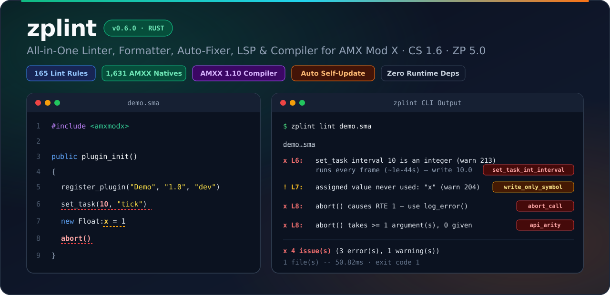
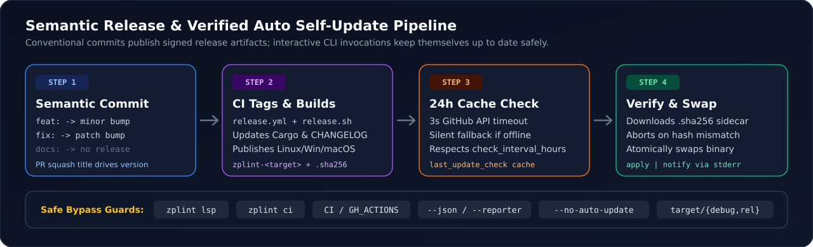
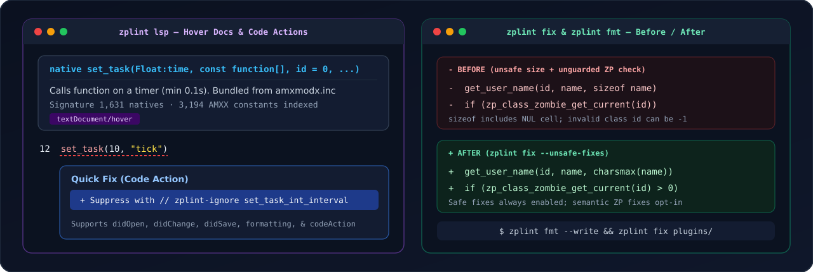
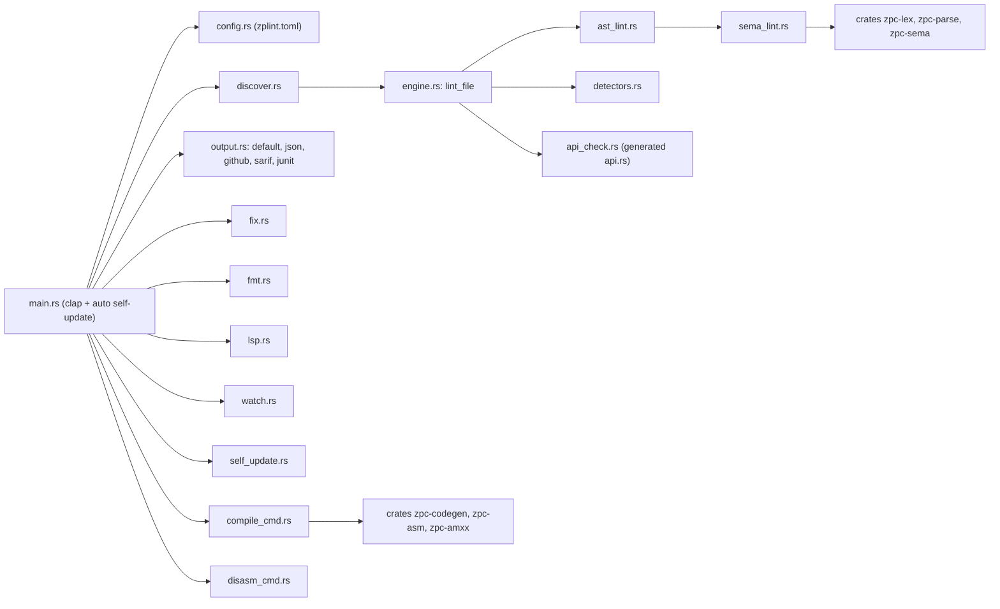
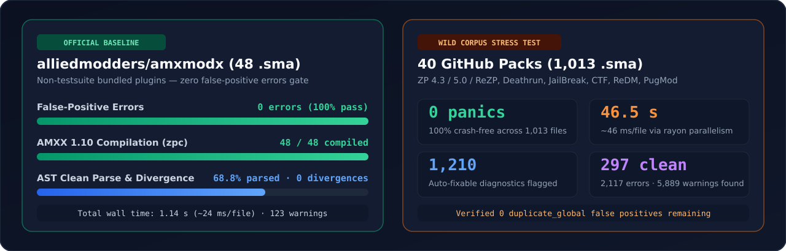

<div align="center">


# zplint

**A fast, all-in-one toolchain for Pawn / AMX Mod X plugins: 165 lint rules, formatter, auto-fixer, LSP server, and AMXX 1.10 compiler in a single binary.**<br/>
Catch compiler errors, HLDS server crashes, engine limit overruns, and Zombie Plague API bugs before a plugin ever loads.

[](https://github.com/juninmd/zplint/actions/workflows/ci.yml)
[](https://github.com/juninmd/zplint/actions/workflows/release.yml)
[](LICENSE)
[](#requirements)
[](#rules)
[](#auto-self-update)

[Installation](#installation) · [Auto Self-Update](#auto-self-update) · [Feature Guide](#how-to-enable-and-use-every-feature) · [Configuration](#configuration-zplinttoml) · [165 Rules](#rules) · [Benchmarks](#corpus-validation--performance)

<br/>



</div>

`zplint` is built in **Rust** for Counter-Strike 1.6 and GoldSrc/HLDS maintainers managing individual `.sma` scripts or large **AMX Mod X** and **Zombie Plague 5.0** server packs. With zero runtime dependencies (no Python, Node.js, or external compiler required to lint), it pairs a regex/API-table analyzer with an AST and semantic front-end (`zpc`) powered by rayon parallelism.

<details>
<summary>Table of Contents</summary>

- [Highlights](#highlights)
- [Requirements](#requirements)
- [Installation](#installation)
- [Auto Self-Update](#auto-self-update)
- [CLI Overview](#cli-overview)
- [How to Enable and Use Every Feature](#how-to-enable-and-use-every-feature)
  - [Linting & CI Mode](#linting--ci-mode)
  - [Rule Selection (`--only` / `--skip`)](#rule-selection---only----skip)
  - [Output Reporters](#output-reporters)
  - [Git Incremental Mode](#git-incremental-mode)
  - [Auto-Fix](#auto-fix)
  - [Code Formatter](#code-formatter)
  - [Editor LSP Integration](#editor-lsp-integration)
  - [Watch Mode](#watch-mode)
  - [Inline Suppressions](#inline-suppressions)
  - [Rule Discovery & Explanations](#rule-discovery--explanations)
  - [AMXX Compiler & Disassembler](#amxx-compiler--disassembler)
- [Configuration (`zplint.toml`)](#configuration-zplinttoml)
- [Architecture](#architecture)
- [Corpus Validation & Performance](#corpus-validation--performance)
- [Rules](#rules)
- [Automated Releases & CI Gates](#automated-releases--ci-gates)
- [Development](#development)
- [Documentation Index](#documentation-index)
- [Security](#security)
- [Known Limitations](#known-limitations)
- [License](#license)

</details>

## Highlights

<div align="center">


</div>

<details>
<summary>Capability Matrix (CLI Commands &amp; Scope)</summary>

| Capability | Command / Mode | What it gives you |
|---|---|---|
| **Static Linter** | `zplint lint`, `zplint ci` | 165 rules across `correctness`, `suspicious`, `performance`, `security`, and `style`; Windows-1252 & `#pragma ctrlchar` aware |
| **AST & Semantic Pass** | Enabled by default (`rules.ast = true`) | Scope-aware unused/write-only variables, use-before-init, bitwise-in-condition, local arity, duplicate globals |
| **Full AMXX API Table** | Automatic | 1,631 native/forward signatures and 3,194 constants across 66 bundled `.inc` headers (arity, tags, includes, typos) |
| **Auto-Fix** | `zplint fix` | 100% safe fixes by default (`charsmax`), opt-in semantic rewrites via `--unsafe-fixes` |
| **Formatter** | `zplint fmt --check` / `--write` | Brace indentation (including braceless blocks), trailing whitespace cleanup, blank-line collapsing, leading `#include` sort |
| **Language Server (LSP)** | `zplint lsp` | JSON-RPC over stdio: live diagnostics, native/constant hover docs, ignore quick-fixes, document formatting |
| **Watch Mode** | `zplint watch` | Incremental re-lint on file save |
| **CI Reporters & Git Diff** | `--reporter`, `--changed`, `--staged` | Native `default`, `json`, `github`, `sarif`, and `junit` formats + git-scoped scanning |
| **Compiler & Disassembler** | `zplint compile`, `zplint disasm` | Compiles `.sma` to AMXX 1.10 `.amxx` binaries and disassembles `.amxx`/`.amx` bytecode |
| **Auto Self-Update** | Automatic + `zplint self-update` | Daily checksum-verified binary updates from GitHub Releases with zero-config setup |

</details>

## Requirements

- **Using a prebuilt release binary:** No dependencies at all.
- **Building from source:** Rust **1.88+** (2024 edition).
- **Optional (maintainer/compiler tests only):** Node.js is only needed to regenerate `src/api.rs` (`scripts/genapi.mjs`) or run the differential compiler oracle (`scripts/difftest.mjs`).

## Installation

### Option 1: Prebuilt Release Binaries (Recommended)

Every tagged release on the [GitHub Releases](https://github.com/juninmd/zplint/releases) page includes standalone binaries, `.sha256` checksums, and packaged archives for:

- **Linux x86_64:** `zplint-x86_64-unknown-linux-gnu`
- **Windows x86_64:** `zplint-x86_64-pc-windows-msvc.exe`
- **macOS Apple Silicon (arm64):** `zplint-aarch64-apple-darwin`

#### Linux

```bash
curl -fsSL https://github.com/juninmd/zplint/releases/latest/download/zplint-x86_64-unknown-linux-gnu -o zplint
curl -fsSL https://github.com/juninmd/zplint/releases/latest/download/zplint-x86_64-unknown-linux-gnu.sha256 -o zplint.sha256
awk '{print $1 "  zplint"}' zplint.sha256 | sha256sum -c -
chmod +x zplint
sudo mv zplint /usr/local/bin/zplint
zplint --version
```

#### macOS (Apple Silicon)

```bash
curl -fsSL https://github.com/juninmd/zplint/releases/latest/download/zplint-aarch64-apple-darwin -o zplint
curl -fsSL https://github.com/juninmd/zplint/releases/latest/download/zplint-aarch64-apple-darwin.sha256 -o zplint.sha256
awk '{print $1 "  zplint"}' zplint.sha256 | shasum -a 256 -c -
chmod +x zplint
sudo mv zplint /usr/local/bin/zplint
zplint --version
```

#### Windows (PowerShell)

```powershell
New-Item -ItemType Directory -Force "$env:LOCALAPPDATA\zplint\bin" | Out-Null
$exe = "$env:LOCALAPPDATA\zplint\bin\zplint.exe"
Invoke-WebRequest "https://github.com/juninmd/zplint/releases/latest/download/zplint-x86_64-pc-windows-msvc.exe" -OutFile $exe
$expected = (Invoke-RestMethod "https://github.com/juninmd/zplint/releases/latest/download/zplint-x86_64-pc-windows-msvc.exe.sha256").Split()[0].ToLower()
$actual = (Get-FileHash $exe -Algorithm SHA256).Hash.ToLower()
if ($expected -ne $actual) { throw "SHA-256 mismatch!" }
# Add $env:LOCALAPPDATA\zplint\bin to your User PATH, then verify:
& $exe --version
```

### Option 2: Install via Cargo from GitHub

```bash
cargo install --git https://github.com/juninmd/zplint
```

### Option 3: Build from Source

```bash
git clone https://github.com/juninmd/zplint
cd zplint
cargo build --release
./target/release/zplint --help
```

> Note: `zplint` is not yet published on crates.io; see [`docs/PUBLISHING.md`](docs/PUBLISHING.md) for the workspace release plan.

## Auto Self-Update

**Automatic self-update is enabled by default** in `zplint` when installed as a standalone CLI binary.

<div align="center">



</div>

### How it works

1. On interactive commands (`lint`, `fmt`, `fix`, `watch`, `compile`, `disasm`, `ast-compare`, `explain`, `rules`), `zplint` checks its local timestamp cache (`~/.cache/zplint/last_update_check` on Linux/macOS, `%LOCALAPPDATA%\zplint\last_update_check` on Windows).
2. At most once every **24 hours** (configurable), it queries the GitHub Releases API with a fast **3-second timeout**. If you are offline or GitHub is unreachable, it fails silently without slowing down or failing your run.
3. When a newer semver release exists, `zplint` downloads the platform binary and `.sha256` checksum, verifies the digest, and atomically replaces the running executable (printing a single status line to `stderr` so `stdout` stays clean).
4. It **automatically skips** contexts where self-modification or network traffic would be unsafe:
   - `zplint lsp` (stdio JSON-RPC frames)
   - `zplint ci` (CI reproducibility)
   - `zplint self-update` (manual update)
   - Machine-readable outputs (`--json`, `--reporter=github|sarif|junit`, `rules --json`)
   - CI environments (`CI=true`, `CI=1`, or `GITHUB_ACTIONS=true`)
   - Local Cargo `target/debug` or `target/release` development builds (unless forced with `ZPLINT_AUTO_UPDATE=1`)

### Configure, notify-only, or disable auto-update

In `zplint.toml`:

```toml
[update]
auto = true                 # set false to disable automatic checks
check_interval_hours = 24   # 0 = check on every eligible interactive run
mode = "apply"              # "apply" (download + SHA-256 verify + swap) or "notify" (stderr message only)
```

Or control it per command / environment:

```bash
zplint --no-auto-update lint plugins/      # skip check for this invocation
ZPLINT_NO_AUTO_UPDATE=1 zplint lint .      # disable via env
ZPLINT_AUTO_UPDATE=0 zplint lint .         # alternative env opt-out
```

### Manual `self-update` commands

```bash
zplint self-update                         # update immediately to the latest GitHub release
zplint self-update --check                 # check only; exits 1 if an update is available
zplint self-update --version v0.5.0        # pin or downgrade to a specific release tag
```

## CLI Overview

Output from `zplint --help`:

```text
Lightning-fast linter for ZP5.0 AMXX plugins

Usage: zplint [OPTIONS] [FILES]... [COMMAND]

Commands:
  lint         Lint .sma files (default)
  lsp          Language Server Protocol over stdio (diagnostics, hover, quick fixes)
  fmt          Format .sma files (indentation, include order, whitespace)
  ci           CI mode: read-only, warnings fail the run
  explain      Print the documentation entry for a rule id
  rules        List every rule with its category, severity and description
  watch        Watch mode: re-lint on file changes
  self-update  Update zplint to the latest GitHub release
  fix          Apply auto-fixes (safe fixes by default)
  compile      Compile a .sma plugin to .amxx
  ast-compare  Lint the given files twice - once through the regex engine, once through the zpc parser - and report the parse rate plus every migrated-rule finding the two paths disagree on
  disasm       Disassemble a compiled .amxx (or raw .amx) plugin
  help         Print this message or the help of the given subcommand(s)

Arguments:
  [FILES]...  Specific .sma files to lint

Options:
      --no-auto-update  Disable automatic self-update check for this run
  -h, --help            Print help
  -V, --version         Print version
```

## How to Enable and Use Every Feature

The CLI snippets below were verified against a synthetic `demo.sma` fixture:

```pawn
#include <amxmodx>

public plugin_init()
{
	register_plugin("Demo", "1.0", "dev")
	set_task(10, "tick")
	new Float:x = 1
	abort()
}

public tick()
{
	client_print(0, print_chat, "tick")
}
```

### Linting & CI Mode

Lint specific files or directories (or omit paths to scan `paths` from `zplint.toml`):

```bash
zplint lint demo.sma
```

```text
demo.sma
  x L6: set_task interval 10 is an integer (warning 213); the bit pattern becomes ~1e-44s (runs every frame) - write 10.0  set_task_int_interval
  x L7: symbol is assigned a value that is never used: "x" (warning 204)  write_only_symbol
  x L8: abort() causes run time error 1 - use log_error() for graceful degradation  abort_call
  x L8: abort() takes at least 1 argument(s), 0 given  api_arity

x 4 issue(s) (3 error(s), 1 warning(s))
  1 file(s) -- 50.82ms
```

**Exit-code behavior & strict CI mode:**

- By default (`zplint lint`), **errors** return exit code `1`; **warnings** report cleanly without failing the command.
- Pass `--error-on-warnings` (or use `zplint ci`, which also disables ANSI color and skips auto-update) to fail on warnings too:

```bash
zplint lint --error-on-warnings --max-diagnostics 50 plugins/
zplint ci plugins/
```

### Rule Selection (`--only` / `--skip`)

Both `--only` and `--skip` are repeatable, accept comma-separated lists, and match exact rule IDs, rule categories (`correctness`, `suspicious`, `performance`, `security`, `style`), `recommended` (everything except `style`), or `all`:

```bash
# Check only security and performance rules
zplint lint --only=security,performance plugins/

# Skip pure style checks during legacy cleanup
zplint lint --skip=style plugins/

# Skip specific rule IDs on one file
zplint lint --skip abort_call,api_arity demo.sma
```

### Output Reporters

Use `--reporter` (`default`, `json`, `github`, `sarif`, `junit`) or `--json` for CI dashboards and code-scanning integration:

```bash
zplint lint --reporter=github demo.sma
```

```text
::error file=demo.sma,line=6,title=set_task_int_interval::set_task interval 10 is an integer (warning 213); the bit pattern becomes ~1e-44s (runs every frame) - write 10.0
::warning file=demo.sma,line=7,title=write_only_symbol::symbol is assigned a value that is never used%3A "x" (warning 204)
::error file=demo.sma,line=8,title=abort_call::abort() causes run time error 1 - use log_error() for graceful degradation
::error file=demo.sma,line=8,title=api_arity::abort() takes at least 1 argument(s)%2C 0 given
```

Other formats:

```bash
zplint lint --json plugins/              # structured JSON with diagnostics & summary
zplint lint --reporter=sarif plugins/    # SARIF 2.1.0 for GitHub Code Scanning
zplint lint --reporter=junit plugins/    # JUnit XML for Jenkins/GitLab/Azure CI
```

### Git Incremental Mode

Scan only files touched in your current Git working tree, staged index, or branch diff:

```bash
zplint lint --changed                    # modified + untracked .sma files vs HEAD
zplint ci --changed --since=origin/main  # changed .sma files relative to main
zplint ci --staged                       # staged .sma files ready for pre-commit
```

### Auto-Fix

Safe fixes preserve semantics (such as replacing `sizeof buf` with `charsmax(buf)`). Semantic fixes (currently rewriting Zombie Plague `if (mode)`/`if (class)` checks to `if (x > 0)`) require opt-in via `--unsafe-fixes`:

```bash
zplint fix plugins/                      # apply 100% safe transforms only
zplint fix --unsafe-fixes plugins/       # also apply semantic ZP rewrites
```

### Code Formatter

`zplint fmt` is a conservative line-based formatter: it indents blocks (including braceless single-statement bodies), trims trailing whitespace, collapses runs of blank lines, and sorts contiguous leading `#include` directives (`<amxmodx>` first), while leaving preprocessor directives, block comments, multi-line strings, and `\` line continuations intact.

```bash
zplint fmt --check plugins/              # CI check: exits 1 if any file would change
zplint fmt --write plugins/              # format files in place
```

### Editor LSP Integration

<div align="center">



</div>

Start the built-in Language Server over stdio with `zplint lsp`. It supports:

- Live diagnostics as you type (`textDocument/didOpen`, `didChange`, `didSave`)
- Hover documentation for all 1,631 natives and 3,194 AMXX constants
- Quick-fix code actions to insert `// zplint-ignore <rule>` on diagnostics
- Document formatting (`textDocument/formatting`)

#### Neovim (`init.lua` built-in LSP)

```lua
vim.api.nvim_create_autocmd("FileType", {
  pattern = { "pawn", "sma" },
  callback = function(ev)
    vim.lsp.start({
      name = "zplint",
      cmd = { "zplint", "lsp" },
      root_dir = vim.fs.root(ev.buf, { "zplint.toml", ".git" }),
    })
  end,
})
```

#### VS Code (with any custom/generic stdio LSP bridge or extension)

Configure the server command as `zplint` with arguments `["lsp"]` for `.sma` / `sourcepawn` / `pawn` files.

### Watch Mode

Keep `zplint watch` open in a terminal while editing plugins in `paths` (`zplint.toml`). Saving any `.sma` file triggers an instant debounced re-lint:

```bash
zplint watch
```

### Inline Suppressions

Suppress false positives or intentional patterns inline using Biome-style comments, optionally scoped to specific rule IDs and followed by `-- <reason>`:

```pawn
abort() // zplint-ignore abort_call -- deliberate crash fixture

// zplint-ignore-next-line get_user_msgid_in_precache -- cached id is refreshed in init
get_user_msgid("TextMsg")

// zplint-ignore-file duplicate_include -- generated wrapper
```

### Rule Discovery & Explanations

List all 165 rules or inspect the rationale, compiler error/warning codes, and upstream references for any rule ID:

```bash
zplint rules                             # table of all 165 rules (id, category, severity, description)
zplint rules --json                      # machine-readable catalog
zplint explain set_task_int_interval     # prints docs/KNOWLEDGE.md entry + severity + sources
```

Example output of `zplint explain set_task_int_interval`:

```text
Rule: set_task_int_interval
Category: correctness
Severity: error
Recommended: yes

### 2.4 int literal in Float slot (warning 213) `[rules: set_task_int_interval, pev_float_int]`
Pawn does NOT convert: the integer bit pattern is reinterpreted as IEEE float.
`set_task(10, ...)` schedules ~1.4e-44 s (runs every frame). `set_pev(id, pev_health, 100)`
sets health to ~1.4e-43 (instant death). Float pev fields: health, gravity, maxspeed, speed,
dmg, takedamage, animtime, framerate, scale, renderamt, frame, fuser1-4.
Sources: https://forums.alliedmods.net/archive/index.php/t-263844.html · ...
```

### AMXX Compiler & Disassembler

`zplint compile` compiles `.sma` files to AMX Mod X 1.10-compatible `.amxx` containers using the built-in `zpc` toolchain (point `-i` / `--include` at your AMXX scripting includes, since third-party `.inc` files are not bundled):

```bash
zplint compile antiflood.sma -i /path/to/amxmodx/plugins/include -o /tmp/antiflood.amxx
```

```text
/tmp/antiflood.amxx - 0 error(s), 0 warning(s), 949 bytes
```

Disassemble any `.amxx` or raw `.amx` binary (`--normalised` strips absolute addresses and jump targets so builds can be diffed):

```bash
zplint disasm /tmp/antiflood.amxx
zplint disasm --normalised /tmp/antiflood.amxx
```

```text
; /tmp/antiflood.amxx - 626 instruction(s), code 0x1b0..0xfe4
00000000  halt 0
00000008  proc
0000000c  load.s.pri 12
00000014  const.alt 1065353216
...
```

Check AST parser coverage and compare AST-migrated rules vs regex rules on your corpus:

```bash
zplint ast-compare plugins/
```

<details>
<summary>Compiler Release Gates (Difftest &amp; Live HLDS Runtime Smoke Test)</summary>

For compiler development, two additional end-to-end validation harnesses live under `scripts/`:

- `scripts/difftest.mjs`: compares accept/reject decisions against a reference `amxxpc` binary across the official plugin corpus and disassembles every `zplint`-generated artifact (`--strict-diagnostics` compares full diagnostic tuples).
- `scripts/runtime-test.ps1`: compiles fixtures with both `amxxpc` and `zplint`, loads both inside a real AMX Mod X 1.10 / HLDS Docker container (`AMXXPC`, `AMXX_INCLUDE_DIR`, `AMXX_CORE`), and verifies runtime execution (`ZPLINT_RUNTIME_PASS`).

</details>

## Configuration (`zplint.toml`)

Place `zplint.toml` in the directory where you run `zplint`. All keys live at the top level (no `[lint]` wrapper); unknown keys are ignored.

```toml
# Folders scanned when running `zplint lint` or `zplint watch` with no arguments
paths = ["addons/amxmodx/scripting"]

# Any path containing one of these substrings is skipped
exclude = ["archive", "disabled"]

[rules]
# Original 37 detectors support individual boolean toggles (default: true)
client_disconnect_guard = true
abort_call = false

# Research-driven & semantic rules can be disabled by ID
disable = ["deprecated_symbols", "get_cvar_hotpath"]

# Set false to bypass the AST/sema pipeline and run the regex engine only
ast = true

[output]
color = true

[update]
# Auto-update installed binaries from GitHub Releases (default: true)
auto = true
# Minimum hours between release checks (cached on disk, default: 24)
check_interval_hours = 24
# "apply" (download + verify SHA-256 + swap binary) or "notify" (stderr alert only)
mode = "apply"
```

> Note: When no `zplint.toml` is present, `paths` defaults to `["meus_plugins_organizados"]` and `exclude` defaults to `["00-Old_Archive"]` — pass explicit file or directory paths such as `zplint lint scripting/`. Invalid TOML falls back silently to defaults (`Config::load(...).unwrap_or_default()`).

## Architecture

`zplint` shares one Pawn lexer, preprocessor, and parser (`crates/zpc-*`) between semantic linting (`src/ast_lint.rs`, `src/sema_lint.rs`) and full `.amxx` compilation (`src/compile_cmd.rs`). During `lint`, files first attempt a clean AST parse; if a third-party macro or non-standard include prevents parsing, the file gracefully falls back to the regex and API-table engines so parser gaps never drop or fabricate diagnostics.



## Corpus Validation & Performance

<div align="center">



</div>

Measured locally with the release build (`rayon` parallel execution) across two corpora:

| Corpus | Files | Lint Result | Speed | Compiler / AST Notes |
|---|---|---|---|---|
| **Official `alliedmodders/amxmodx`** (excl. `testsuite`) | 48 `.sma` | **0 errors**, 123 warnings | **1.14 s** (~24 ms/file) | **48/48** compile cleanly; **33/48** (68.8%) clean AST parse, **0** AST/regex divergences |
| **40 GitHub AMXX & Zombie Plague packs** (ZP 4.3/5.0/Special/ReZP, Deathrun, ReDM, JailBreak, CTF, KZ, ChatAdditions, PugMod) | 1,013 `.sma` | **0 panics**; 2,117 errors, 5,889 warnings, 1,210 auto-fixable (297 files clean) | **46.5 s** (~46 ms/file, including massive multi-thousand-line total conversions) | Uncovered and eliminated Pawn state-function & shared enum `duplicate_global` false positives (verified 0 remaining) |

Single-file runs take ~50 ms cold (`demo.sma`), and legacy Windows-1252 encoded `.sma` scripts are decoded without skipping lines.

## Rules

`zplint rules` prints all **165 rules** with their category, severity, and short description. **This file is embedded in the binary at compile time** (`include_str!` in `src/rule_meta.rs` and `src/main.rs`) to populate `zplint rules` and fallback descriptions in `zplint explain` — preserve all table rows beginning with ``| `id` `` verbatim.

Severity model:
- **Errors** flag crash paths, server hangs, or compilation failures and return exit code `1`.
- **Warnings** flag performance, security hygiene, API modernization, or code style and only fail CI when using `zplint ci` or `--error-on-warnings`.

### Player Validation (8)
| Rule | Severity | Fix | Description |
|------|----------|-----|-------------|
| `client_disconnect_guard` | error | ❌ | Risky natives in client_disconnected without guard |
| `dangerous_forward_guard` | error | ❌ | Risky natives in fw_Killed/Ham_Killed/fw_Spawn |
| `message_begin_guard` | error | ❌ | message_begin(MSG_ONE) with unvalidated index -> `svc_bad` |
| `find_entity_in_sphere` | error | ❌ | FindEntityInSphere result used as player |
| `loop_player_guard` | error | ❌ | 1-32 loop without is_user_connected guard |
| `attacker_not_validated` | error | ❌ | TakeDamage handler uses attacker without is_user_alive (attacker = 0/world) |
| `zp_infect_cure_guard` | error | ❌ | zp_core_infect/cure without is_zombie check |
| `zp_force_no_guard` | error | ❌ | zp_core_force_infect/cure bypasses validation |

### Entities & Memory (9)
| Rule | Severity | Fix | Description |
|------|----------|-----|-------------|
| `create_entity_guard` | error | ❌ | create_entity without is_valid_ent check |
| `nested_message` | error | ❌ | Nested message_begin without message_end (crashes server) |
| `message_write_outside` | error | ❌ | write_* outside message_begin/message_end (crashes server) |
| `message_end_without_begin` | error | ❌ | message_end without message_begin (crashes server) |
| `message_hook_scope` | error | ❌ | get_msg_arg*/set_msg_arg* outside register_message callback |
| `hardcoded_message_id` | error | ❌ | numeric message id in message_begin (use get_user_msgid/constant) |
| `array_random_empty` | error | ❌ | ArrayGet* with random ArraySize()-1 without non-empty guard |
| `touch_spam` | warning | ❌ | Touch handler spams client_print |
| `precache_sound` | error | ❌ | emit_sound with custom sound never precached |

### Zombie Plague API Usage (5)
| Rule | Severity | Fix | Description |
|------|----------|-----|-------------|
| `zp_gamemode_if` | error | ✅ | `if (mode)` should be `if (mode > 0)` |
| `zp_class_if` | error | ✅ | `if (class)` should be `if (class > 0)`; also checks `zp_class_*_register()` in wrong scope |
| `zp_items_register_check` | error | ❌ | zp_items_register() return value not checked |
| `precache_outside_precache` | error | ❌ | precache_*() called in plugin_init() not plugin_precache() -> crash |
| `library_exists_hotpath` | warning | ❌ | LibraryExists() per-hit in TakeDamage (cache as bool) |

### General AMXX (10)
| Rule | Severity | Fix | Description |
|------|----------|-----|-------------|
| `set_task_public` | error | ❌ | set_task callback is non-public function |
| `registered_callback_public` | error | ❌ | menu/register callback is non-public function |
| `read_data_multi_context` | error | ❌ | read_data() in event + non-event callback |
| `pev_oldbuttons` | warning | ❌ | pev_oldbuttons unreliable in PreThink |
| `get_user_origin` | warning | ❌ | get_user_origin() loses float precision |
| `task_interval_zero` | error | ❌ | set_task with interval 0.0 (minimum 0.1) |
| `set_task_flags` | error | ❌ | set_task invalid flags/repeat usage |
| `percent_n_player_name` | error | ❌ | `%n` player-name formatter can throw on invalid index |
| `menu_handler_destroy` | error | ❌ | dynamic menu_create handler does not call menu_destroy |
| `fopen_close` | error | ❌ | fopen handle is not closed with fclose in same function |

### Code Smells (5)
| Rule | Severity | Fix | Description |
|------|----------|-----|-------------|
| `abort_call` | error | ❌ | abort() causes run time error 1 |
| `precache_sound_sprite` | error | ❌ | precache_sound on sprite-named variable (use precache_model) |
| `buffer_size` | warning | ✅ | Hardcoded buffer < 64 in get_user_* (use charsmax) |
| `client_cmd_spk` | warning | ❌ | client_cmd(0, "spk...") instead of emit_sound |
| `hardcoded_maxplayers` | warning | ❌ | loop uses `#define MAXPLAYERS 32` as runtime player count |

## Research-Driven Detectors

Documented from compiler internals, crash reports, and API contracts (sources in [`docs/KNOWLEDGE.md`](docs/KNOWLEDGE.md)). Every rule is enabled by default and can be toggled via `rules.disable` in [`zplint.toml`](#configuration-zplinttoml).

### Compiler Structure (9)
| Rule | Severity | Description |
|------|----------|-------------|
| `unbalanced_braces` | error | File ends with unmatched `{`/`}` (errors 030/054, cascades into 010/004) |
| `unbalanced_preprocessor` | error | `#if`/`#else`/`#endif` stack errors (026/060/061) |
| `unterminated_string` | error | Odd quote count on a line (error 037); escape-char and continuation aware |
| `else_paren` | error | `else (cond)` instead of `else if (cond)` (error 029/010) |
| `empty_statement` | error | `if (...)`/`while (...)` terminated by `;` detaches the block (error 036) |
| `stacked_case` | error | `case A:` `case B:` — Pawn has no fallthrough; use `case A, B:` |
| `line_too_long` | warning | Line > 511 chars (error 075 on amxxpc 1.8.x) |
| `array_index_oob` | error | Literal out-of-bounds array write, e.g. `Players[32] = 15` on a 32-slot array (valid 0-31) |
| `array_compare_by_ref` | error | `arr1 == arr2` compares array references, not contents — doesn't compile in Pawn |

### Correctness (14)
| Rule | Severity | Description |
|------|----------|-------------|
| `string_literal_compare` | error | `== "..."` — strings need equal()/equali() (error 033) |
| `string_assign` | warning | String literal larger than the destination array (error 047) |
| `forward_arity` | error | Known forward defined with wrong parameter count (error 025) |
| `formatex_self` | error | formatex() output buffer also used as input (corrupts output) |
| `assignment_in_condition` | warning | `if (x = 1)` (warning 211); `((x = y))` idiom is allowed |
| `comparison_as_statement` | warning | `x == 5;` as a statement does nothing (warning 215) |
| `self_assignment` | warning | `x = x;` (warning 226) |
| `constant_condition` | warning | `if (0)` / `if (1)` dead-codes a branch (warnings 205/206) |
| `unreachable_code` | warning | Statements after an unconditional return (warning 225) |
| `contain_truthy` | warning | contain() returns -1 on miss — bare truthiness inverts the logic |
| `strcmp_truthy` | warning | strcmp() returns 0 on match — bare `if (strcmp(..))` means "differs" |
| `sql_fieldname_truthy` | warning | `SQL_FieldNameToNum()` returns -1 on miss — bare truthiness misreads column 0 as failure |
| `func_id_truthy` | warning | `get_func_id()`/`get_xvar_id()` return -1 on failure but id 0 is valid — bare truthiness (direct or via variable) misreads it as failure |
| `global_shadowing` | warning | Local `new` shadows a global (warning 219) |

### Tag Mismatch: Warning 213 with Runtime Impact (13)
| Rule | Severity | Description |
|------|----------|-------------|
| `set_task_int_interval` | error | `set_task(10, ..)` → interval becomes ~1e-44s (runs every frame) |
| `pev_float_int` | error | Integer into Float pev field (pev_health 100 → ~1.4e-43 = instant death) |
| `int_native_float` | error | Float into int native (set_user_health(id, 100.0) → 1120403456 hp) |
| `engfunc_int_float` | error | Float literal into an engfunc() int/entity slot, checked positionally across ~20 EngFunc_* signatures (WalkMove mode, hull, WriteByte value, ...) |
| `engfunc_float_int` | error | Int literal into an engfunc() Float slot, same table, reverse direction (e.g. `EngFunc_WriteCoord(36)` instead of `36.0`) |
| `entity_ev_type_mismatch` | error | Engine module `entity_set_int(id, EV_FL_gravity, ..)` — EV_* prefix names the real family (int/float/vector/edict/string/byte), function used doesn't match |
| `ham_int_float` | error | Float literal into an ExecuteHam(B)/Ham_* int slot (e.g. Ham_Use's use_type) |
| `ham_float_int` | error | Int literal into an ExecuteHam(B)/Ham_* Float slot (e.g. `Ham_TakeDamage` damage passed as `25` instead of `25.0`) |
| `set_ham_param_mismatch` | error | `SetHamParamInteger(4, ..)` inside a `Ham_TakeDamage` hook — slot 4 is `Float:damage`, wrong setter used regardless of the value passed |
| `cs_float_int` | error | Int literal into a cstrike.inc Float setter (`cs_set_c4_explode_time`, `cs_set_user_lastactivity`, `cs_set_hostage_lastuse/nextuse`) |
| `fun_float_int` | error | Int literal into `set_user_maxspeed`/`set_user_gravity`'s Float parameter |
| `amxmodx_int_float` | error | Float literal into a `set_hudmessage`/`set_dhudmessage`/`emit_sound`/`change_task` int slot |
| `amxmodx_float_int` | error | Int literal into a `set_hudmessage`/`set_dhudmessage`/`emit_sound`/`change_task` Float slot (fxtime, holdtime, vol, att, newTime, ...) |

### Runtime Crashes (7)
| Rule | Severity | Description |
|------|----------|-------------|
| `userid_as_index` | error | `arr[get_user_userid(id)]` — userid is a session counter, not an index (RTE 4) |
| `player_array_32` | error | `new arr[32]` indexed by player id — overflows on full server (RTE 4) |
| `find_ent_no_advance` | error | Entity-search loop restarting from a constant — infinite loop, server freeze |
| `deathmsg_killer_guard` | error | DeathMsg `read_data(1)` can be 0 (world kills) — guard before use |
| `div_by_runtime` | warning | Division by get_playersnum()/cvar that can be zero (RTE 11) |
| `pragma_dynamic_stack` | warning | Local array ≥ 2048 cells without `#pragma dynamic` (RTE 3) |
| `format_injection` | warning | User text (read_args/get_user_name) as format string — `%` in chat crashes |

### HLDS & Engine Limits (10)
| Rule | Severity | Description |
|------|----------|-------------|
| `precache_mp3` | error | .mp3 through precache_sound/emit_sound — never plays; use precache_generic |
| `sound_prefix` | error | `"sound/..."` prefix — paths are already relative to sound/ |
| `model_not_precached` | error | Literal model set but never precached (fatal SV_ModelIndex) |
| `mp3_loading_path` | warning | Client stufftext filter silently blocks paths containing "loading" |
| `te_reliable` | warning | SVC_TEMPENTITY on MSG_ALL/MSG_ONE — reliable-channel overflow kicks |
| `precache_in_loop` | warning | precache_* inside a loop risks the 512-entry engine limit |
| `entity_leak` | warning | create_entity with no removal path — "ED_Alloc: no free edicts" |
| `hud_channel_range` | warning | set_hudmessage channel outside 1-4/-1 |
| `changelevel_cmd` | warning | server_cmd changelevel bypasses forwards and map validity check |
| `geoip_code_overflow` | error | `geoip_code2/3()` overflow their result buffer by one cell on an unknown IP — use the `_ex` variant |

### API Contracts & Modernization (8)
| Rule | Severity | Description |
|------|----------|-------------|
| `callback_not_defined` | warning | Registered callback string has no function in the file ("function not found") |
| `client_command_handled` | warning | PLUGIN_HANDLED in client_command starves other plugins (use _MAIN) |
| `client_connect_actions` | warning | Client-affecting natives in client_connect (too early; use putinserver) |
| `deprecated_symbols` | warning | client_disconnect / md5 / strbreak (AMXX 1.9 warning 233) |
| `define_reserved_const` | warning | Redefining MAX_PLAYERS etc. from amxconst.inc (warning 201) |
| `get_cvar_hotpath` | warning | get_cvar_* outside init — use cached pcvars ("dozens of times faster") |
| `strlen_in_loop` | warning | strlen() in loop condition — O(n²) |
| `buffer_in_loop` / `read_file_loop` | warning | Array re-zeroed per iteration / O(n²) file API in loops |

### Zombie Plague 5.0 API (6)
| Rule | Severity | Description |
|------|----------|-------------|
| `zp_fw_attacker_guard` | error | zp_fw_core_infect/cure `attacker` is 0 for gamemode/admin infections |
| `zp_select_pre_filter` | warning | select_pre returns restrictive ZP_* without using itemid/classid — blocks ALL items |
| `zp_select_pre_return` | warning | PLUGIN_HANDLED in select_pre (=NOT_AVAILABLE) / ZP_* in core _pre forwards |
| `zp50_register_return` | warning | Registration id discarded — cannot filter forwards for your item/class |
| `zp50_get_in_init` | warning | zp50 query natives in plugin_init ("Invalid Array Handle" load-order bug) |
| `zp43_mixing` | warning | ZP 4.3 API (`<zombieplague>`) mixed with zp50 includes |

### Semantic Warnings (4)
| Rule | Severity | Description |
|------|----------|-------------|
| `unused_symbol` | warning | Local/global declared but never read (amxxpc warning 203) |
| `write_only_symbol` | warning | Assigned but never read (warning 204) |
| `use_before_init` | warning | Scalar read before its first assignment (warning 210; Pawn does not zero scalars) |
| `unintended_bitwise` | warning | `&`/`|` between two boolean expressions (warning 212) |

### Security & Player Contracts (5)
| Rule | Severity | Description |
|------|----------|-------------|
| `sql_injection` | warning | User-controlled `%s` in `SQL_PrepareQuery`/`SQL_ThreadQuery` without `SQL_QuoteString` |
| `resource_leak_on_return` | warning | Handle freed later but leaked by an early `return` (path-aware) |
| `get_players_flags` | warning | Contradictory `get_players` flags (`ab`, `cd`) or `e`/`f` without the team/name argument |
| `find_player_flags` | warning | `find_player` userid match (`k`) combined with name/authid flags |
| `read_data_bounds` | warning | `read_data(N)` outside the event's argument range |

### Contracts, Includes & Tooling (5)

| Rule | Severity | Description |
|------|----------|-------------|
| `menu_handler_handled` | warning | `menu_create` handler never returns `PLUGIN_HANDLED` (legacy menu handlers can also consume the selection) |
| `get_user_msgid_in_precache` | warning | `get_user_msgid()` in `plugin_precache` returns 0 on the first server start |
| `duplicate_include` | warning | Duplicate `#include` in `<...>` or `"..."` form |
| `unknown_pragma` | warning | `#pragma` outside amxxpc's vocabulary (warning 207, silently ignored) |
| `sizeof_scalar` | warning | `sizeof` on a scalar is always 1 (warning 223) |

### Compiler Parity, Contracts, Performance, Security & Style (12)

| Rule | Severity | Description |
|------|----------|-------------|
| `duplicate_global` | error | Duplicate declaration in the same scope (error 021) |
| `sizeof_function` | error | `sizeof` applied to a function or native symbol (error 072) |
| `mixed_array_return` | error | Function mixes array/string and scalar return values (error 079) |
| `in_file_arity` | warning | Call to an in-file function with wrong argument count (warning 202 / error 092) |
| `nested_comment` | warning | Nested `/*` inside an open block comment (warning 216) |
| `sql_thread_signature` | error | `SQL_ThreadQuery` handler declares more than 7 parameters |
| `cvar_pointer_null` | warning | Local `get_cvar_pointer()` handle used without checking for 0 |
| `path_traversal` | warning | File operation receives user-controlled path without checking `..`/separators |
| `array_size_in_loop` | warning | `ArraySize()` recomputed every iteration in a non-mutating loop condition |
| `get_players_in_loop` | warning | `get_players()`/`get_players_ex()` called inside a loop |
| `if_equals_true` | warning | Redundant `== true` / `!= false` comparison in condition |
| `boolean_return` | warning | `if (cond) return true; else return false;` can be simplified to `return cond` |

Note: `callback_not_defined` / `registered_callback_public` cover command/menu/message registrations as well as `register_event`, `register_forward`, `RegisterHam*`, `register_think`, `register_touch`, `register_impulse`, and `register_logevent`; `handle_leak` / `handle_use_after_destroy` track 24 constructor/destructor pairs across array, trie, stack, datapack, tr2, kvd, forward, SQL/DBI, nvault, regex, socket, SMC/INI parser, and JSON handles (globals remain exempt).

See [`docs/BIOME_PARITY.md`](docs/BIOME_PARITY.md) for the rule research matrix and prioritized roadmap.

## Automated Releases & CI Gates

Workflows under `.github/workflows/` automate quality checks and release publishing:

- **CI (`ci.yml`)**: `cargo clippy --workspace --all-targets -- -D warnings`, `cargo test --workspace` on Ubuntu/Windows/macOS, MSRV **1.88** check (`cargo check --workspace --all-targets`), `cargo package --workspace --no-verify`, and `cargo audit` (RustSec).
- **Semantic PR Title (`semantic-pr.yml`)**: PR titles must follow [Conventional Commits](https://www.conventionalcommits.org), because squash merges use the PR title as the commit message on `master`.
- **Automatic Semantic Releases (`release.yml` + `scripts/release.sh`)**: every push to `master` inspects commits since the last `v*` tag:
  - `feat:` → minor bump (`0.5.0` → `0.6.0`)
  - `fix:` / `perf:` → patch bump (`0.5.0` → `0.5.1`)
  - `type!:` or `BREAKING CHANGE:` → major bump (minor while `0.x`)
  - `docs:`, `chore:`, `ci:`, `test:`, `refactor:`, `style:`, `build:` → no release
  When a bump is due, CI updates `Cargo.toml`, `Cargo.lock`, and `CHANGELOG.md`, tags `vX.Y.Z`, cross-compiles binaries + `.sha256` + archives for Linux/Windows/macOS, and publishes the GitHub Release consumed by auto `self-update`.
- **Security Scan (`security.yml`)**: shared security scanning workflow via `juninmd/base-actions`.

## Development

See [`CONTRIBUTING.md`](CONTRIBUTING.md) and [`AGENTS.md`](AGENTS.md) before opening a PR.

```bash
cargo build --workspace                                   # Debug build
cargo build --release                                     # Release build
cargo test --workspace                                    # Full test suite
cargo clippy --workspace --all-targets -- -D warnings     # Strict Rust lint (CI gate)
```

> Do not run `cargo fmt` over files you are not modifying; the codebase predates rustfmt and there is no `cargo fmt --check` CI gate.

To regenerate `src/api.rs` from upstream AMX Mod X `.inc` headers (never hand-edit `src/api.rs`):

```bash
node scripts/genapi.mjs <amxmodx-clone>/plugins/include src/api.rs
cargo test
```

## Documentation Index

| Document | Contents |
|---|---|
| [`docs/KNOWLEDGE.md`](docs/KNOWLEDGE.md) | Documented problem, consequence, and upstream sources for every rule |
| [`docs/BIOME_PARITY.md`](docs/BIOME_PARITY.md) | Feature parity research, gap matrix, and backlog |
| [`docs/COMPILER_MIGRATION.md`](docs/COMPILER_MIGRATION.md) | Architecture, milestones, and non-goals for the `zpc` compiler |
| [`docs/DIVERGENCES.md`](docs/DIVERGENCES.md) | Deliberate divergences between `zpc` and `amxxpc` |
| [`docs/LICENSING.md`](docs/LICENSING.md) | Engineering rules keeping GPL code out of the repository |
| [`docs/PUBLISHING.md`](docs/PUBLISHING.md) | Step-by-step workspace publishing guide for crates.io |
| [`CHANGELOG.md`](CHANGELOG.md) | Release history |
| [`SECURITY.md`](SECURITY.md) | Threat model and private vulnerability reporting |

## Security

- Both manual `zplint self-update` and background auto-updates verify downloaded executables against the `.sha256` digest published in the same GitHub Release before swapping the binary on disk (`src/self_update.rs`).
- Never report security vulnerabilities in a public GitHub issue; follow [`SECURITY.md`](SECURITY.md) to submit a private GitHub Security Advisory.

## Known Limitations

- Not yet published on crates.io — install via [GitHub Releases](#option-1-prebuilt-release-binaries-recommended) or `cargo install --git`.
- `zplint compile` requires external AMX Mod X `.inc` headers via `-i` / `--include`.
- Generated `.amxx` binaries match AMX Mod X 1.10 runtime behavior rather than being byte-for-byte identical to `amxxpc`.
- Running `zplint lint` with no arguments scans `paths` from `zplint.toml` (falling back to the author's default `meus_plugins_organizados`); pass file or folder arguments explicitly outside configured projects.
- Invalid `zplint.toml` syntax silently falls back to defaults.

## License

Licensed under the [Apache License, Version 2.0](LICENSE).

The `zpc` compiler crates incorporate portions derived from ITB CompuPhase's Pawn compiler (zlib-style license). **`zpc` is a modified derivative**, not the original software; full attribution notices live in [`NOTICE`](NOTICE), [`ATTRIBUTION.md`](ATTRIBUTION.md), and [`docs/LICENSING.md`](docs/LICENSING.md).

Unless you explicitly state otherwise, any contribution intentionally submitted for inclusion in this repository is licensed under Apache-2.0 without additional terms or conditions.
